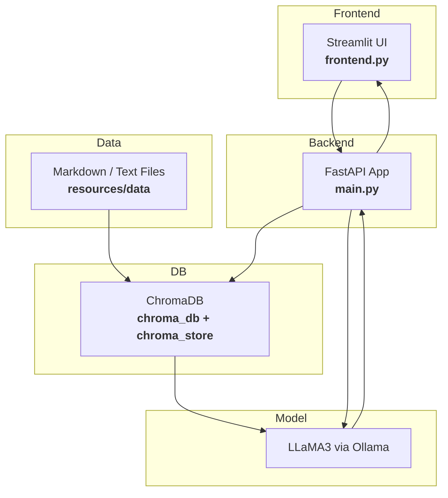

# 🤖 FinSolve Role-Based Chatbot

A secure, intelligent chatbot powered by **LLMs + Vector Search (RAG)** — with **role-based access control (RBAC)** for Finance, HR, Engineering, Marketing, Employees, and C-Level Executives.

---

## 🧩 Problem Background

**FinSolve Technologies**,  a leading FinTech company, was experiencing communication delays and fragmented document access across teams like Finance, HR, Marketing, Engineering, and C-Level Executives. These issues led to slower decision-making and operational inefficiencies, as teams lacked a centralized, secure way to access internal knowledge specific to their roles.

---

## 🧠 Solution Overview
To address this issue, an internal AI chatbot was developed using Retrieval Augmented Generation (RAG) and Role-Based Access Control (RBAC). It ensures that every user receives accurate, secure, and role-relevant information instantly.

This chatbot solves FinSolve's data access problem using:
- 🧠 **RAG (Retrieval-Augmented Generation)** via LLaMA 3 (Ollama)
- 🔐 **Role-Based Filtering** at the vector search level
- ⚡ **FastAPI + Streamlit** for interactive chat and login
- 🧾 **Documents** stored per department with metadata

---

## 👥 Role-Based Access Control (RBAC)

| Role               | Permissions                                                                 |
|--------------------|-----------------------------------------------------------------------------|
| C-Level Executives | Full unrestricted access to all documents                                   |
| Finance Team       | Financial reports, expenses, reimbursements                                 |
| Marketing Team     | Campaign performance, customer insights, sales data                         |
| HR Team            | Employee handbook, attendance, leave, payroll                               |
| Engineering Dept.  | System architecture, deployment, CI/CD                                      |
| Employees          | General information (FAQs, company policies, events)                        |

---

## 🚀 Features

### 🔐 Secure Role-Based Search
- Each user sees **only** their permitted data
- C-level users get **unfiltered** access

### 💬 Interactive Chat Interface
- Built with **Streamlit**
- Login panel with session persistence
- Typing animation + Chat history
- 👍👎 feedback buttons
- Role access transparency shown in every response

### 🔎 Context-Aware Retrieval
- Vector DB powered by **Chroma**
- Embeds `.md` files per department with metadata (`role`, `category`)
- Queries run through vector similarity → LLM → Answer


---

## 🛠 Tech Stack

| Layer         | Tool/Library             |
|---------------|--------------------------|
| Frontend      | Streamlit                |
| Backend       | FastAPI                  |
| Embeddings    | SentenceTransformers     |
| Vector DB     | ChromaDB                 |
| LLM           | LLaMA 3 (via Ollama)     |
| Doc Format    | Markdown (.md)           |

---

## 🧪 Sample Users & Roles

| Username | Password     | Role              |
|----------|--------------|-------------------|
| Alice    | ceopass      | c-levelexecutives |
| Bob      | employeepass | employee          |
| Tony     | password123  | engineering       |
| Bruce    | securepass   | marketing         |
| Sam      | financepass  | finance           |
| Natasha  | hrpass123    | hr                |

---

## 🚀 Project Architecture



## 📁 Project Structure

```
DS-RPC-01/
├── app/
│   ├── __pycache__/
│   ├── chroma_db/
│   ├── chroma_store/
│   ├── embed_documents.py
│   ├── frontend.py
│   └── main.py
│
├── resources/
│   └── data/
│       ├── engineering/
│       ├── finance/
│       ├── general/
│       ├── hr/
│       └── marketing/
│
├── README.md
└── requirements.txt
```


## ⚙️ Setup Instructions

Install the dependencies:

```bash
pip install -r ../requirements.txt
```

### 1. In a new terminal, start the LLaMA 3 model using Ollama:

```bash
ollama run llama3
```
📝 Keep this terminal open — it runs the local LLM engine.
The first run will download the model (~3–4 GB).

### 2. Go back to the backend terminal and start the FastAPI server:

```bash
uvicorn main:app --reload
```

### 3. 💬 Frontend Setup (Streamlit UI)
In another new terminal:

```bash
cd frontend
streamlit run frontend.py
```
🔗 Visit: http://localhost:8501

### 4. 📄 Embed Documents (Run Once Before Use)
To embed documents into ChromaDB:

```bash
python embed_documents.py
```

This script:
Loads documents from the data/ folder
Generates embeddings using sentence-transformers
Stores them in ChromaDB with role-based metadata

✅ Once these steps are done, your role-based chatbot is fully set up and ready to use! 


